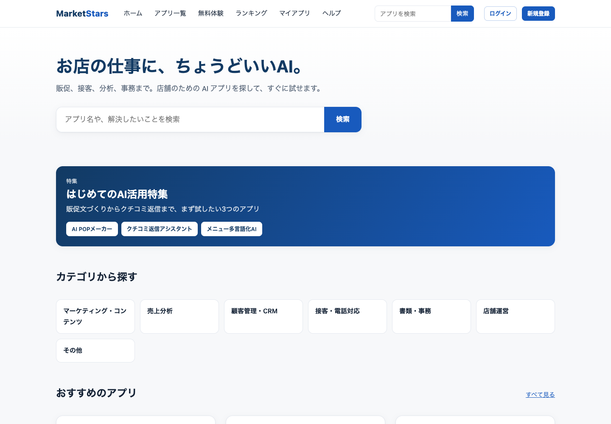
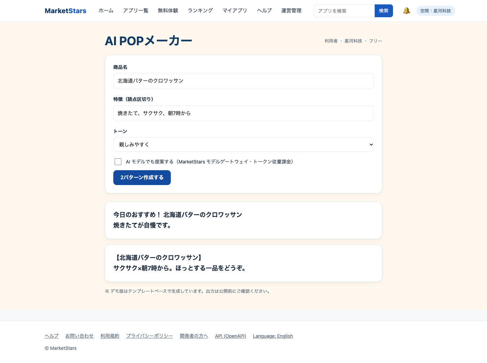
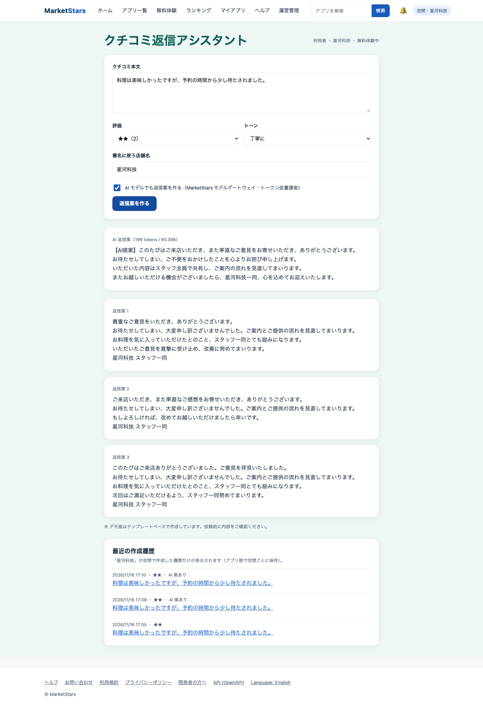
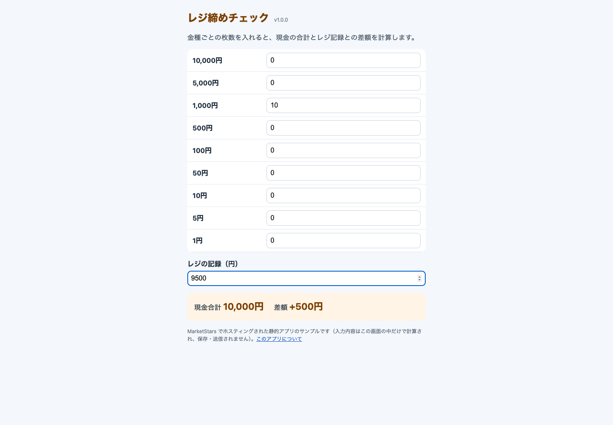
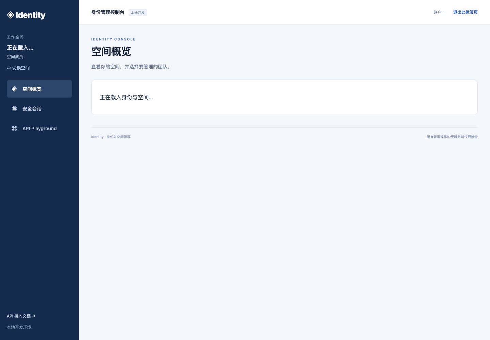
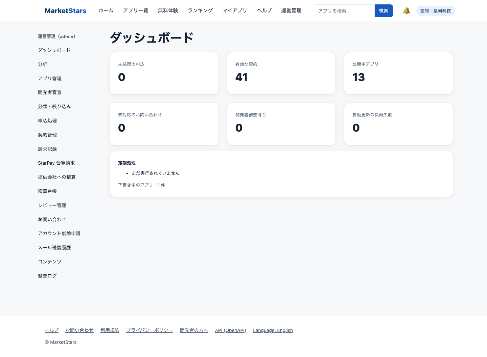
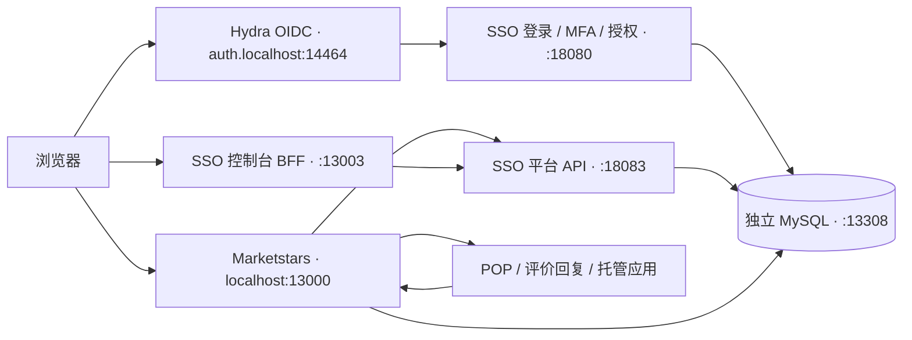

# Marketstars × SSO 本地联合演示

> **此页为已准备好的 Mac 联合演示说明。** 文中的启动脚本、`scripts/demo`、私有账号文件和运行目录，均位于本机 `/Users/lidawei/Documents/ChatGPT/marketplace`；不是从本仓库根目录执行。此 `master` 分支保留 Marketstars 产品源码，原产品安装/开发 README 见 [Marketstars 开发说明](docs/marketstars-development.md)。

> **演示时间：2026 年 11 月 17 日（周二）上午 11:00，日本时间。**
>
> 已更新两个项目的主干，完成生产构建和 15 项真实浏览器彩排。本次验收后冻结版本；明天直接打开本地页面，不需要拉代码、安装依赖或重新构建。请保持这台 Mac **开机、接电、不合盖**。



Marketstars 是面向商店的 AI 应用市场，SSO 提供统一账号、MFA、空间、组织与权限。本项目将二者组合成可直接操作的本地演示：从发现应用、统一登录、按空间开通，到启动应用、查看运营与开发者后台。

## 明天直接这样演示

**照着操作：** [一页简明指南](docs/demo-quickstart.md)。包含完整账号密码的本机版位于 `.local/明天演示简明指南.md`，不会上传 GitHub。

1. 打开 [Marketstars 市场](http://localhost:13000)。如页面未运行，在 Finder 双击项目里的 `启动演示.command`，等待检查通过。
2. 查看本机私有登录资料：`/Users/lidawei/Documents/ChatGPT/marketplace/.local/demo-credentials.md`。使用 **owner** 账号，SSO 授权时选择 **星河科技**。
3. 在终端粘贴下面的命令，获取当前动态验证码。验证码每 30 秒更换，同一组成功使用后需要等下一组。

```bash
/Users/lidawei/Documents/ChatGPT/marketplace/scripts/demo code owner
```

项目目录为 `/Users/lidawei/Documents/ChatGPT/marketplace`. Finder 按 `⌘⇧G` 可直接输入该路径。登录资料中的密码、TOTP 密钥和恢复码不进入 Git，也不要在投屏中打开。

| 入口 | 本地地址 | 演示用途 |
| --- | --- | --- |
| Marketstars | [localhost:13000](http://localhost:13000) | 发现、开通和使用应用 |
| 我的应用 | [localhost:13000/my/apps](http://localhost:13000/my/apps) | 已开通的 POP、评价回复与托管应用 |
| SSO 控制台 | [console.localhost:13003](http://console.localhost:13003) | 空间、成员、组织、角色、应用接入 |
| SSO 账户 | [auth.localhost:18080/account](http://auth.localhost:18080/account) | 注册及账户相关入口 |
| 市场运营 | [localhost:13000/admin](http://localhost:13000/admin) | 应用、合同、账单、合算请款等后台 |
| 开发者 | [localhost:13000/developer](http://localhost:13000/developer) | 应用管理、上架申请与托管构建 |

请固定使用 `localhost:13000` 访问市场，避免混用 `127.0.0.1`。不同端口的 localhost Cookie 不隔离；与其他本地项目一起演示时，使用独立 Chrome 个人资料或无痕会话。

## 一条完整主线，约 10 分钟

| 顺序 | 操作 | 可以说明的价值 |
| --- | --- | --- |
| 1 · 发现 | 首页搜索、分类、应用详情；当前有 **13 款**已发布示范应用 | 商户找到适合自己的 AI 工具 |
| 2 · 登录 | 共通账号登录 → 密码与 MFA → 选择星河科技 | 市场复用 SSO 的真实身份和空间 |
| 3 · POP | 我的应用 → AI POPメーカー → アプリを開く → 输入商品与特点 | 一次性启动码、权益检查和文案生成 |
| 4 · 评价回复 | クチコミ返信アシスタント → 输入两星评价 → 生成回复 | 第二款接入应用、30 天试用、模型网关和空间内历史 |
| 5 · 托管 | レジ締めチェック → 打开 → 1,000 円输入 10 张，账面输入 9,500 | 静态应用托管、10,000 円合计、+500 円差额与 sandbox 隔离 |
| 6 · SSO | 账户页进入共通 SSO 控制台，展示组织和成员 | 统一组织、成员与权限管理 |
| 7 · 隔离 | 切换到远山合作社，再切回星河科技 | 应用和合同按空间隔离，其他空间不能进入运营后台 |
| 8 · 后台 | 星河科技下打开运营和开发者入口 | 运营资格与空间所有者分别校验，提供者可以管理自己的应用 |

POP 免费版、评价回复试用、托管免费应用已在星河科技开通，可直接使用。若现场还要展示全新开通，可选未开通的「シフト作成AI」免费方案。部分目录应用的外部链接为占位地址；推荐使用上表中已验收的三款可操作应用。

### POP 文案：开通后的应用体验

输入“北海道バターのクロワッサン”和商品特点，生成多种店头宣传文案。接入应用只取得自身的应用会话，不接收市场 access token。



### 评价回复：第二款接入应用

生成三种回复草案，可同时展示本地模型网关的模拟输出、Token 用量和按空间保存的历史。截图中的金额是演示计量记录，不是真实扣款。



### 静态应用托管：现金盘点

托管的 HTML/CSS/JS 通过市场的订阅权益检查后运行。浏览器使用 CSP sandbox 隔离；计算在应用页面内完成。



### SSO：统一空间与权限

owner 管理星河科技及远山合作社，auditor 为只读成员。控制台已有研发中心、平台组、产品组和商务协作等合成组织数据。



### 运营管理

市场运营入口只允许具有明确运营资格、并处于运营空间的账号访问；普通成员与其他空间均被拒绝。



## 本地联合架构



| 部分 | 实际行为 |
| --- | --- |
| 身份与授权 | 真实 Hydra、OAuth Authorization Code + S256 PKCE、MFA、SSO 平台 API、空间与角色检查 |
| 市场会话 | 服务端保存 Token，浏览器使用 HttpOnly 会话 Cookie |
| 应用接入 | 一次性启动码兑换、独立应用会话、每次使用前检查订阅权益 |
| 模型与支付 | 本地确定性 mock / 模板和模拟账单；未配置外部模型、真实支付凭证，不产生真实扣费 |
| 浏览器外部依赖 | 彩排中禁止非本地浏览器请求后，市场与接入应用仍可正常操作；字体与静态资源在本机 |
| 数据 | 独立数据库及账号，保留现有登录、MFA、空间、合同；不执行清库播种 |

容器、网络和数据库卷使用 `marketplace-local-demo` 项目名，避开本机其他服务。原开发目录 `/Users/lidawei/workplace/marketstars`、`/Users/lidawei/workplace/sso` 的工作区不参与演示构建。

## 已验收并冻结的版本

| 项目 | 跟踪主干 | 本次固定提交 |
| --- | --- | --- |
| Marketstars | main | [5530d679f0b2](https://github.com/lth2015/marketstars/commit/5530d679f0b25ededce76aeccc9df50baf125034) · 静态应用托管 |
| SSO | master | [2f36359b410d](https://github.com/lth2015/sso/commit/2f36359b410d4178eec9ce79e3aa14f71fb71f69) · BFF 运行配置与安全会话 |

确切版本见 [演示版本记录](docs/local-demo/sources.json)，冻结时间、演示时间与验收分项见 [冻结与验收记录](docs/local-demo/demo-freeze.json)。通过验收后不再自动拉取代码或重建。

**2026-11-16 验收：** 15 项真实浏览器检查通过，涵盖密码/TOTP、13 款应用目录、真实 OAuth 回调、HttpOnly 会话、免费订阅、POP 启动、评价回复试用/模型网关/历史、托管计算与 sandbox、运营/开发者、空间隔离及越界 URL、成员权限、单应用退出和浏览器本地依赖。市场生产构建及 SSO 编译成功，数据库迁移通过原有校验机制。

市场进程异常退出恢复实测通过：约 **5.8 秒**恢复数据库就绪响应，冻结版本保持不变。

原始验收报告在 `.local/rehearsal.json`，运行恢复记录在 `.local/runtime-recovery-20261116.json`，更新及回退材料在 `.local/releases/`。截图为本机真实页面，仅使用合成数据，不包含密码、MFA 密钥或访问令牌。

## 明天的启动与恢复

终端命令先进入项目目录：

```bash
cd /Users/lidawei/Documents/ChatGPT/marketplace
scripts/demo readiness     # 查看冻结版本及当前就绪状态
scripts/demo code owner    # 管理员动态验证码
scripts/demo code auditor  # 只读成员动态验证码
scripts/demo up            # 恢复当前固定版本，不拉新代码
scripts/demo status        # 查看本项目容器
```

正常情况下明天只需打开浏览器。已为长期运行的九个容器设置 `unless-stopped` 重启策略；本地进程守护只恢复已构建的市场服务，不拉代码、不构建、不迁移、不播种。守护和临时防睡眠覆盖到 **11 月 17 日 12:00**。保持电脑开机、接电且不合盖；主动关机、退出 Docker 或合盖会中断本地演示。

如果电脑发生重启，先登录桌面、启动 Docker Desktop，再双击 `启动演示.command`。构建文件和镜像均已在本地，启动不需要重新安装依赖。需要停止时使用 `停止演示.command`，会保留数据并暂停守护恢复。

| 问题 | 处理 |
| --- | --- |
| 市场打不开 | 先启动 Docker Desktop，再双击启动脚本；查看 `.local/logs/marketstars.log` |
| MFA 被拒绝 | 等下一组 30 秒验证码，再执行 `scripts/demo code owner` |
| 运营页被拒绝 | 使用 owner，并在 SSO 选择星河科技；运营权限不是普通空间 owner 权限 |
| 显示其他本地项目的状态 | 使用独立 Chrome 个人资料或无痕会话，固定 localhost:13000 |
| SSO 预检一项 warning | Hydra 未在 discovery 宣告 platform:read；真实授权与平台 API 已通过，预检无 FAIL |

## 演示完成后再维护

冻结期间，`update`、`rebuild`、`prepare`、`seed`、`rollback` 和 `rehearse` 会被拒绝；启动、状态检查和取验证码仍可用。只有再次明确要求改动时，才解冻并更新。

```bash
scripts/demo unfreeze
scripts/demo update --check
scripts/demo update
```

更新先在独立副本构建，保留旧代码、镜像与数据库卷，再切换并自动彩排；失败恢复上一版。回退恢复更新前的数据时点，更新后的数据仍保留在新卷中。不要在演示前执行 db:seed、重置演示数据、删除卷或清理保留镜像。

## 本机演示项目导航

下表中的脚本与运行目录均指本机 `/Users/lidawei/Documents/ChatGPT/marketplace`。GitHub 本分支提供图文文档、截图和非敏感版本记录。

| 路径 | 内容 |
| --- | --- |
| [docs/demo-runbook.md](docs/demo-runbook.md) | 演示者逐步操作与现场恢复 |
| [docs/rebuild.md](docs/rebuild.md) | 更新、构建与回退机制 |
| [docs/local-compatibility.md](docs/local-compatibility.md) | Mac、Docker、Compose 和端口适配记录 |
| `scripts/demo` | 统一命令入口 |
| `scripts/refresh-demo.ts` | 非破坏性补齐新增目录、接入与托管演示 |
| `scripts/ready-watch.py` | 有限时段的本地进程恢复 |
| `sources/marketstars` / `sources/sso` | 本项目独立源码副本，不进入 Git |
| `runtime/sso` | SSO 本地适配及构建，不进入 Git |
| `.local/` | 私有凭证、日志、截图原件、SQL 快照与验收记录，不进入 Git |

本地机器特定的 Node DNS preload 解析 `*.localhost`，不修改 hosts。SSO 交叉编译为 Docker 使用的 Linux ARM64；Go 工具链按候选项目的 go.mod 选择。Hydra 配置打入本地镜像，邮箱用专用 named volume，避免旧版 Docker Desktop 的宿主机挂载问题。
